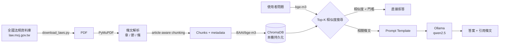

# Taiwan Transport Policy QA — 台灣運輸法規問答系統

以自然語言詢問台灣的公路與運輸法規，例如「闖紅燈罰多少？」、「汽車運輸業分為哪幾種？」。
系統以 RAG（Retrieval-Augmented Generation）先從法規條文中檢索相關內容，再交給本機 LLM 生成答案，
並附上**法規名稱、條號與官方連結**。

Embedding、向量資料庫與 LLM 全部在本機執行：**不需要任何 API Key，也不會把資料上傳到雲端**。


```
$ python scripts/ask.py "公路的主管機關是誰？"

答：公路的主管機關是中央為交通部；在直轄市為直轄市政府；在縣（市）為縣（市）政府。（公路法第 3 條）

※ 本回答僅供參考，不構成法律意見，實際適用請以全國法規資料庫公告之最新條文為準。

參考來源：
  - 公路法 第 3 條（相似度 0.733）https://law.moj.gov.tw/LawClass/LawAll.aspx?pcode=K0040001
  - 公路法 第 6 條（相似度 0.692）https://law.moj.gov.tw/LawClass/LawAll.aspx?pcode=K0040001
  ...
```

---

## 要解決的問題

一般人想查交通法規時，通常得自己翻全國法規資料庫，或是依賴搜尋引擎與網路文章。前者要先知道是哪一部法規、哪一條；
後者來源不明，數字也可能過時。直接問通用的聊天機器人則有另一些問題：

- **會產生幻覺：** LLM 可能編造不存在的條號，或給出錯誤的罰鍰金額，而且語氣非常肯定。
- **無法追溯：** 答案沒有附上出處，使用者無從查證。
- **資料外流：** 雲端服務需要把問題送到外部，也需要 API Key 與費用。

這個專案的目標是：**只根據真實條文作答、每個答案都能追溯到條號，且整套系統在本機離線運作。**

## 功能

- **自然語言問答：** 單次提問或互動模式，答案以 streaming 逐字輸出，並列出引用條文、相似度與官方連結。
- **只用檢索：** 不經 LLM，直接查看 Top-K 相關條文；可限定單一法規，或用 MMR（Maximal Marginal Relevance）讓結果更多元。
- **拒答機制：** 檢索相似度低於門檻時直接拒答，**完全不呼叫 LLM**，從源頭避免模型硬掰答案。
- **檢索評估：** 內建人工標註的測試題組，一行指令算出 Hit@K 與 MRR。
- **完全本機、可離線：** 第一次下載模型後，設定 `HF_HUB_OFFLINE=1` 就能完全離線運作。
- **可重現：** 法規資料由腳本從官方網站自動下載，並提供鎖定版本的 `requirements-lock.txt`。

問到與法規無關的問題時，系統直接拒答：

```
問：推薦一部好看的電影
答：根據目前資料庫中的法規條文，找不到與此問題相關的內容，因此無法回答。……
```

## 收錄法規

| PCODE | 法規 | 條文數 | Chunks |
| --- | --- | --- | --- |
| [K0040001](https://law.moj.gov.tw/LawClass/LawAll.aspx?pcode=K0040001) | 公路法 | 98 | 104 |
| [K0040003](https://law.moj.gov.tw/LawClass/LawAll.aspx?pcode=K0040003) | 汽車運輸業管理規則 | 181 | 191 |
| [K0040012](https://law.moj.gov.tw/LawClass/LawAll.aspx?pcode=K0040012) | 道路交通管理處罰條例 | 127 | 152 |

條文數與 chunks 數依法規版本而定，上表為 2026-11 下載的版本，已刪除的條文不計入。
想新增法規，只要在 [`scripts/download_laws.py`](scripts/download_laws.py) 的 `LAWS` 加入 PCODE（法規網址中的 `pcode=` 參數）即可。

## 設計重點

### 依法規結構切塊（[`chunker.py`](src/transport_qa/chunker.py)）

一般 RAG 常用固定長度切塊，但法規最小的語意單位是「條」，固定長度會把一條法規切得支離破碎。

| 步驟 | 做法 |
| --- | --- |
| 切出條文 | 以正規表示式 `^第 N(-M) 條$` 切出每一條，並追蹤所在的章與節。 |
| 修復斷行 | 修復 PDF 固定寬度造成的斷行，但保留「項」（`1 `）、「款」（`一、`）、「目」（`（一）`）的換行。 |
| 長度控制 | 一條不超過 500 字就整條當成一個 chunk（多數條文如此，長度中位數 165 字）。超過 500 字才再細切，依序優先在換行、`。`、`；`、`，` 處切開，前後重疊 80 字。 |
| 加上標頭 | 每個 chunk 開頭加上 `【道路交通管理處罰條例 第 7-1 條】（第一章 總則）`。即使長條文被切開，每一段仍知道自己屬於哪部法規、哪一條，對 Embedding 與 LLM 引用都有幫助。 |
| 略過刪除條文 | 內容只有「（刪除）」的條文不進入向量庫。 |

### 相似度門檻（`MIN_SIMILARITY = 0.5`）

以 bge-m3 實測：與法規相關的問題，Top-1 cosine similarity 約 **0.65～0.75**；無關的問題（例如天氣、電影）約 **0.35～0.45**。
以 0.5 作為門檻，就能把無關問題擋在 LLM 之前。這道防線寫在程式裡（[`rag_chain.py`](src/transport_qa/rag_chain.py)），
沒有檢索到條文時直接回傳固定的拒答訊息，而不是交給 LLM 判斷。

### 法規問答 Prompt（[`prompts.py`](src/transport_qa/prompts.py)）

- 只能根據【參考條文】作答，不可加入外部知識。
- 句末用「（法規名稱第N條）」標註出處。
- 罰鍰、期間、年齡等數字必須和條文完全一致。
- `temperature=0.1`，降低模型自由發揮的程度。
- 免責聲明由程式附加，不交給 LLM 決定，確保每次都會出現。

## 檢索評估

[`tests/retrieval_cases.json`](tests/retrieval_cases.json) 收錄 8 題人工標註的問題，每題標註應命中的條文
（例如「酒後駕車會被處罰多少錢？」→ 道路交通管理處罰條例第 35 條）。

| 指標 | 結果 |
| --- | --- |
| Hit@5 | **100%**（8/8） |
| MRR | **1.000** |

```bash
python scripts/search.py --eval
```

## 系統架構



| 元件 | 技術 |
| --- | --- |
| 框架 | LangChain 1.x |
| PDF 解析 | PyMuPDF |
| Embedding | [BAAI/bge-m3](https://huggingface.co/BAAI/bge-m3)（多語、1024 維，繁體中文表現佳） |
| 向量資料庫 | ChromaDB（cosine、本機持久化） |
| LLM | [Ollama](https://ollama.com) + `qwen2.5:3b`（可換成 7b 或其他模型） |

## 架設與開發

**需要：** Python 3.10 以上（已驗證 3.12）、[Ollama](https://ollama.com/download)。
RAM 8 GB 可搭配 `qwen2.5:3b`，16 GB 以上建議改用 `qwen2.5:7b`；硬碟約需 6 GB（PyTorch、bge-m3 約 2.3 GB、qwen2.5:3b 約 1.9 GB）。
不需要 GPU，純 CPU 即可執行；已在 Windows 11 上驗證。

1. **安裝 Ollama 並下載模型：**
   ```bash
   winget install Ollama.Ollama      # macOS: brew install ollama
                                     # Linux: curl -fsSL https://ollama.com/install.sh | sh
   ollama pull qwen2.5:3b            # 約 1.9 GB；回答品質較好可改用 qwen2.5:7b（約 4.7 GB）
   ```
   安裝後 Ollama 會在背景執行（`http://localhost:11434`），沒有自動啟動時請執行 `ollama serve`。
2. **安裝 Python 套件：**
   ```bash
   git clone https://github.com/Ping-Hsun-Chiang/RAG-transport-policy-qa.git
   cd RAG-transport-policy-qa
   python -m venv .venv
   .\.venv\Scripts\Activate.ps1         # macOS / Linux: source .venv/bin/activate
   pip install -r requirements-lock.txt # 鎖定版本；或 requirements.txt 安裝最新相容版本
   ```
   NVIDIA GPU 使用者可先依 [PyTorch 官網](https://pytorch.org/get-started/locally/) 安裝 CUDA 版 torch，Embedding 會快很多。
3. **下載法規並建立向量資料庫：**
   ```bash
   python scripts/download_laws.py     # 下載 3 部法規 PDF
   python scripts/build_chunks.py      # （選用）檢查切塊結果
   python scripts/build_index.py       # Embedding 並寫入 ChromaDB
   ```
   第一次執行會從 Hugging Face 下載 bge-m3（約 2.3 GB）。純 CPU 筆電上 447 個 chunks 約需 9 分鐘，有 GPU 只要幾十秒。
   重複執行會以固定 ID 覆蓋，不會產生重複資料；修改切塊策略後請加上 `--reset` 重建。
4. **開始問答：**
   ```bash
   python scripts/ask.py "公路的主管機關是誰？"                       # 單次提問
   python scripts/ask.py                                              # 互動模式（輸入 exit 離開）
   python scripts/ask.py "闖紅燈罰多少？" --show-context --model qwen2.5:7b
   ```

只用檢索（不經 LLM）：

```bash
python scripts/search.py "酒後駕車會被處罰多少錢？" -k 3
python scripts/search.py "汽車運輸業分為哪幾種？" --law 公路法   # 只搜尋某一部法規
python scripts/search.py "闖紅燈罰多少？" --mmr                   # 用 MMR 讓結果更多元
python scripts/search.py --eval                                  # 檢索評估
```

### 設定

所有設定都有預設值，**不建立 `.env` 也能執行**。需要調整時複製 [`.env.example`](.env.example) 為 `.env`，或直接設定環境變數：

| 變數 | 預設值 | 說明 |
| --- | --- | --- |
| `OLLAMA_MODEL` | `qwen2.5:3b` | Ollama 模型名稱 |
| `OLLAMA_NUM_GPU` | （空，由 Ollama 自動決定） | 設為 `0` 強制使用 CPU |
| `OLLAMA_BASE_URL` | `http://localhost:11434` | Ollama 服務位址 |
| `EMBEDDING_MODEL` | `BAAI/bge-m3` | Hugging Face Embedding 模型 |
| `EMBEDDING_DEVICE` | （空，自動選擇） | `cpu` / `cuda` |
| `TOP_K` | `5` | 檢索的 chunk 數量 |
| `MIN_SIMILARITY` | `0.5` | 相似度門檻 |
| `HF_HUB_OFFLINE` | — | 設為 `1` 完全離線（需先下載過模型） |

### 疑難排解

| 狀況 | 解法 |
| --- | --- |
| Ollama 回應 `llama-server process has terminated: exit status 0xe06d7363` | Ollama 的 Vulkan 後端不支援部分較舊的 GPU 或內顯（日誌 `%LOCALAPPDATA%\Ollama\server.log` 會出現 `does not support 16-bit storage`）。在 `.env` 加入 `OLLAMA_NUM_GPU=0` 改用 CPU 推論。 |
| `Cannot connect to Ollama` 或 `Model not found` | 確認 Ollama 正在執行（`ollama serve`），並已下載模型（`ollama list`）。 |
| PowerShell 無法執行 `Activate.ps1` | `Set-ExecutionPolicy -Scope CurrentUser RemoteSigned` |
| Windows 終端機中文亂碼或 `UnicodeEncodeError` | `$env:PYTHONUTF8 = "1"` |
| Hugging Face 出現 symlinks 或 HF_TOKEN 警告 | 不影響功能，下載公開模型也不需要 token。可設定 `HF_HUB_DISABLE_SYMLINKS_WARNING=1` 關閉提示。 |

## 專案結構

```
scripts/
  download_laws.py       Step 1：從全國法規資料庫下載法規 PDF
  build_chunks.py        Step 2：解析與切塊（檢查用）
  build_index.py         Step 3：Embedding 並建立向量庫
  search.py              Step 4：Top-K 檢索、檢索評估
  ask.py                 Step 5：RAG 問答（單次／互動模式）
src/transport_qa/
  config.py              所有設定（可用 .env 覆寫）
  pdf_loader.py          PDF → 文字 + metadata
  chunker.py             依條文切塊
  embeddings.py          bge-m3
  vectorstore.py         ChromaDB
  retriever.py           相似度搜尋、法規篩選、MMR、相似度門檻
  prompts.py             法規問答 Prompt Template、拒答訊息、免責聲明
  rag_chain.py           RAG 主流程（retrieve → prompt → ChatOllama）
tests/
  retrieval_cases.json   檢索評估題組
data/
  raw/                   下載的法規 PDF（不進版控）
  processed/             chunks.jsonl（不進版控）
vectorstore/             ChromaDB 資料（不進版控）
requirements.txt         套件版本下限
requirements-lock.txt    鎖定版本（已驗證可用）
```

## 已知限制

- `qwen2.5:3b` 是小模型，偶爾會漏標出處或改寫錯主詞。程式產生的「參考來源」清單一定正確，可以對照檢查；
  需要更好的回答品質時，請改用 `qwen2.5:7b` 或更大的模型（`--model qwen2.5:7b`）。
- 目前只收錄 3 部法規，回答範圍僅限於這些條文，沒有涵蓋子法、函釋或判決。
- 檢索評估題組只有 8 題，樣本數小，Hit@5 = 100% 不代表所有問題都能檢索正確。
- 法規會修正，請定期執行 `python scripts/download_laws.py --force` 與 `python scripts/build_index.py --reset` 更新資料。

## 未來規劃

- 加入 Reranker（如 `BAAI/bge-reranker-v2-m3`）提升排序品質
- Hybrid Search（bge-m3 sparse 向量 + BM25）
- Web UI（Gradio / Streamlit）
- 擴充法規：大眾運輸發展條例、鐵路法、大眾捷運法等
- 擴充檢索評估題組，並以 LLM-as-a-judge 評估生成品質

## 資料來源與授權

- 法規資料來自法務部[全國法規資料庫](https://law.moj.gov.tw)。依《著作權法》第 9 條，法律、命令不屬於著作權保護的標的。
  本 repo **不含**任何 PDF，資料由使用者自行從官方網站下載。
- 本系統的回答**僅供參考，不構成法律意見**，實際適用請以全國法規資料庫公告的最新條文為準。
- 程式碼以 [MIT License](LICENSE) 授權。
